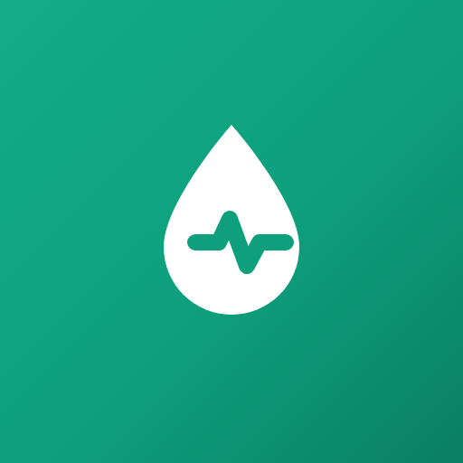
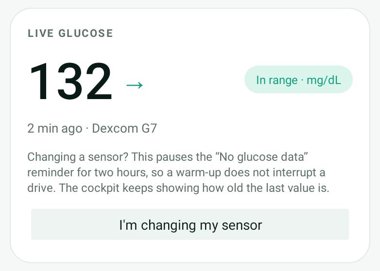
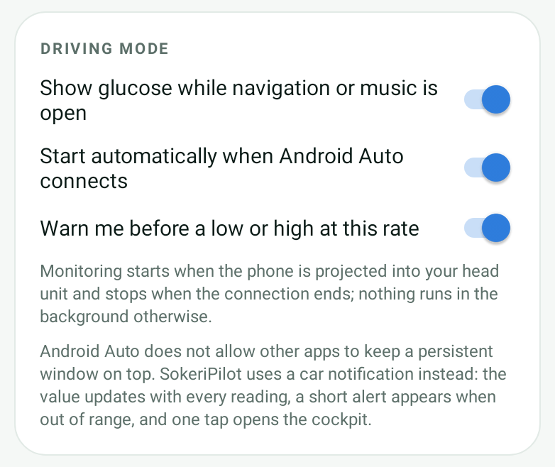
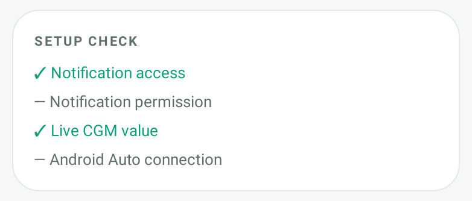
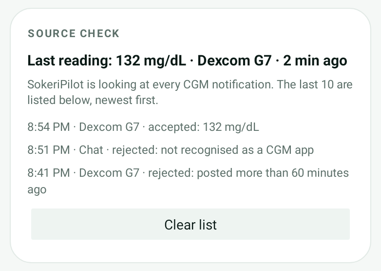
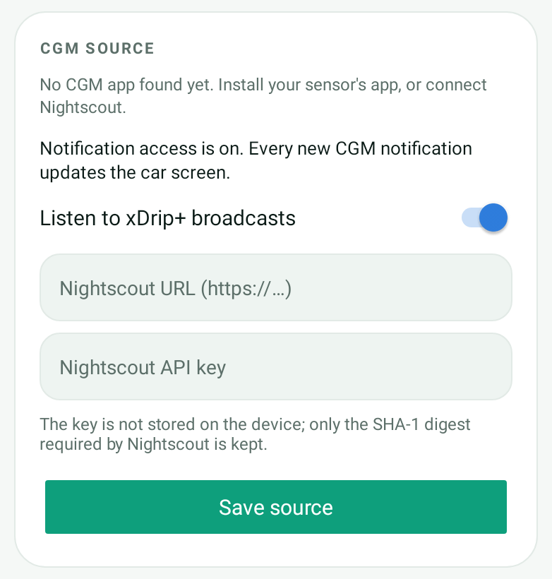
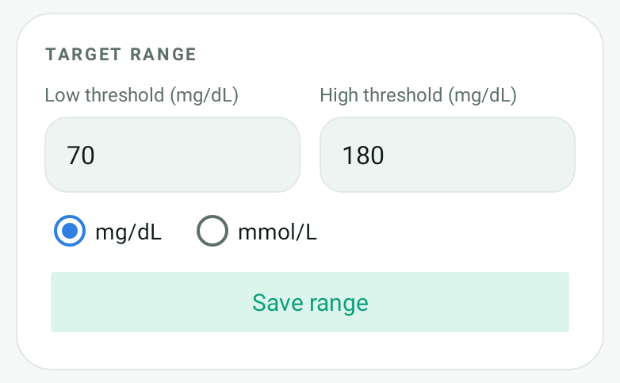
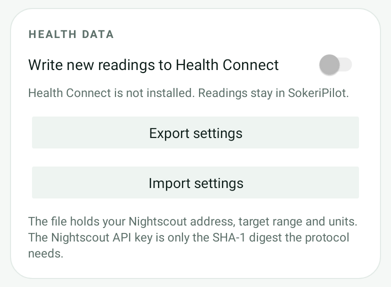
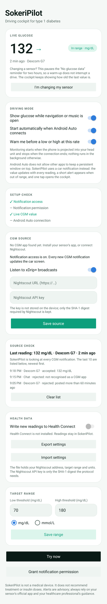

# SokeriPilot



**A bright, driver-focused Android Auto cockpit for people with type 1 diabetes.** SokeriPilot reads
the CGM app you already use — through its notification, an xDrip+ local broadcast, or your own
Nightscout server — and puts one large, legible value on the car screen: number, trend arrow, band
and reading age. No dosing advice, no account, no analytics, nothing uploaded.

[](LICENSE)
[](landing/releases.json)
[](#4-requirements-and-install)
[](#why-the-car-app-library)
[](https://github.com/ErdalBirinci/SokeriPilot/actions/workflows/ci.yml)
[](https://github.com/ErdalBirinci/SokeriPilot/actions/workflows/pages.yml)

**Source:** <https://github.com/ErdalBirinci/SokeriPilot> ·
**Site:** <https://glucopilot-civgdk.freebuff.site> ·
**GitHub Pages mirror:** <https://erdalbirinci.github.io/SokeriPilot/>

> **Medical notice:** SokeriPilot is not a medical device. It does not recommend treatment or
> insulin doses. Alerts are advisory; always rely on your sensor's official app and your healthcare
> professional's guidance.

---

## At a glance

| | |
| --- | --- |
| **Version** | 1.2.1 (versionCode 7) — signed APK, 920,044 bytes |
| **Package** | `app.glcopilot` (install id, kept for updates) · code namespace `app.sokeripilot` |
| **Platform** | Android 8.0+ (API 26), targetSdk 35 · Android Auto via Car App Library 1.7.0 |
| **Car category** | `androidx.car.app.category.IOT` (CGM as an IoT health device) |
| **CGM sources** | Notification listener (default), xDrip+ broadcast, Nightscout REST |
| **Data leaves the device?** | Only if *you* configure Nightscout or turn on Health Connect. Otherwise no. |
| **Accounts, ads, analytics, tracking** | None |
| **License** | MIT |
| **Cost** | Free, no in-app purchases |

### Contents

1. [Screenshots](#1-screenshots)
2. [What it does](#2-what-it-does)
3. [How it works](#3-how-it-works)
4. [Requirements and install](#4-requirements-and-install)
5. [Setup in five minutes](#5-setup-in-five-minutes)
6. [CGM compatibility](#6-cgm-compatibility)
7. [Alert policy](#7-alert-policy)
8. [Privacy and security](#8-privacy-and-security)
9. [Tests and verification](#9-tests-and-verification)
10. [Project layout](#10-project-layout)
11. [Build, sign and release](#11-build-sign-and-release)
12. [Troubleshooting](#12-troubleshooting)
13. [Known limits](#13-known-limits)
14. [Contributing](#14-contributing)
15. [Ideas not yet built](#15-ideas-not-yet-built)
16. [License and credits](#16-license-and-credits)

---

## 1. Screenshots

These are **real renders of the shipped phone layout**, not mock-ups: an off-device Robolectric test
draws the actual layout with the actual resources and writes `build/reports/phone-screen.png`
(`PhoneScreenRenderTest`). The car screen cannot be captured the same way — Car App Library
templates are drawn by the host — so the only honest car-side artefact is the trend bitmap the app
itself produces, shown further down.

<table>
<tr>
<td width="50%" valign="top">

<p><b>Live glucose.</b> Value in a size you can read at arm's length, band pill, source and age.
The sensor-change button pauses the “No glucose data” reminder for two hours while a new sensor
warms up.</p>
</td>
<td width="50%" valign="top">

<p><b>Driving mode.</b> Monitoring starts when the phone is projected and stops when the cable is
pulled; nothing runs in the background otherwise and nothing starts at boot.</p>
</td>
</tr>
<tr>
<td valign="top">

<p><b>Setup check.</b> Four rows that answer “why is nothing on the car screen?” without log
files: notification access, notification permission, a live CGM value, the car connection.</p>
</td>
<td valign="top">

<p><b>Source check.</b> The last ten CGM-looking notifications, each marked accepted or rejected
with the reason. Kept in memory only — it disappears with the process.</p>
</td>
</tr>
<tr>
<td valign="top">

<p><b>CGM source.</b> The notification path needs no configuration at all. xDrip+ broadcasts switch
on automatically when xDrip+ is installed; Nightscout is optional and HTTPS-only.</p>
</td>
<td valign="top">

<p><b>Target range.</b> 55–120 low and 120–300 high are accepted; mg/dL or mmol/L for display.
The same thresholds drive the cockpit bands and every alert.</p>
</td>
</tr>
<tr>
<td valign="top">

<p><b>Health data.</b> Health Connect export is optional, write-only and off by default. Settings
export contains the Nightscout URL, range and units — never the raw API key.</p>
</td>
<td valign="top">

<p><b>The car trend bitmap.</b> This file is the actual output of <code>TrendImage</code>, drawn for
the cockpit's image slot: last 90 minutes, target band behind the line, newest point marked.
Generated by <code>TrendImageTest</code>.</p>
</td>
</tr>
</table>

<details>
<summary><b>The whole phone screen in one image</b> (tall: 411 × 2307, the layout as rendered)</summary>



</details>

Regenerate the images after a UI change — one command:

```bash
python tools/doc-images.py --gradle   # run the render tests, then crop
python tools/doc-images.py            # crop the render that already exists
python tools/doc-images.py --check    # exit 1 if the committed images are stale
```

[`tools/doc-images.py`](tools/doc-images.py) finds the cards in
`android/app/build/reports/phone-screen.png` by their canvas colour — no hard-coded pixel offsets —
and writes the seven card crops, the full screen, and copies the trend bitmap and the icon. It
fails loudly when the number of cards changes, so a new card cannot silently fall out of the
README. It needs Python 3.9+ and Pillow.

---

## 2. What it does

### Car screen (Android Auto)

- **At a glance:** value, trend arrow and band label (“In range”, “Low”, “Urgent low”, “High”, …).
- **Second line:** source, reading age, session-scoped time in range, sensor battery (when the CGM
  app states it) and the CGM app's own warm-up / signal-loss / sensor-end state.
- **Trend line:** the last 90 minutes over the target band, drawn into the cockpit image slot.
- **Stale data:** a clear 15-minute warning instead of an old number that looks current.
- **“Low soon” / “High soon”:** when the measured rate of change would cross a threshold within
  30–45 minutes, at most once per half hour and muteable like the range alerts.
- **“Got it”** on an urgent low: stops the five-minute repeat for half an hour.
- **Actions:** “Refresh” and “Recent readings” (last 12 readings).
- **Templates only:** `PaneTemplate` / `ListTemplate`, the Car App Library's driver-safety
  surface. No free drawing, no video, no keyboard.
- **While Maps or music is open:** a silent, persistent car notification with value, trend and age.
  One tap returns to the cockpit; Back returns to the app you came from.
- **Out of range:** a short high-priority alert with a “Mute 30 min” action.

### Phone

| Card | What it does |
| --- | --- |
| **Live glucose** | Value, trend, band, source age; “I'm changing my sensor” pause |
| **Driving mode** | Background monitoring, auto-start on projection, before-range warnings |
| **Setup check** | Notification access, notification permission, live value, car connection |
| **CGM source** | Notification path status, xDrip+ switch, Nightscout URL + API key |
| **Source check** | Last reading and the last 10 accepted/rejected notifications with reasons |
| **Health data** | Optional write-only Health Connect export; settings export/import |
| **Target range** | Low/high thresholds (55–120 / 120–300 mg/dL) and mg/dL ↔ mmol/L |
| **Last drive** | Minutes, time in range, lowest value, low count — on the phone, never uploaded |

Plus the Android 13+ notification-permission flow, and a “Grant notification permission” button
that only appears when it is actually needed.

### Alerts

- Only outside the target bands, at most one notification per band every 10 minutes.
- An urgent low (54 mg/dL or below) repeats every five minutes, at most three times; “Got it”
  quiets the repeat for half an hour.
- A projection alert when the current slope crosses the low or high threshold inside the horizon,
  labelled “Low soon” / “High soon”, throttled to once per 30 minutes.
- One quiet “Sensor battery low” notice at 15% or less, once per low-battery episode.
- A single **“No glucose data”** reminder when readings that were flowing in this session stop for
  15 minutes, cleared the moment fresh data returns. `StaleGuard` keeps it to one alert per stale
  episode, so a silent sensor never leaves a stale number looking current.
- Only readings that arrive **after monitoring started** count as flowing data: a sensor change or
  warm-up leaves a value that was already on the phone — shown as an age in the cockpit and
  notification instead of an alarm.
- The phone's **“I'm changing my sensor”** button, and a **“Sensor change”** action on the
  reminder itself, pause the reminder for two hours. It returns on its own if the sensor is still
  silent when the pause ends.
- Car notifications go through `CarAppExtender` on a high-priority channel; repeats are silent.

---

## 3. How it works

```
Android Auto host
   │  (template requests)
   ▼
SokeriPilotCarAppService ──► Session ──► GlucoseScreen / TrendScreen
                                              │ StateFlow
                                              ▼
                                   GlucoseRepository  ◄── XDripBroadcastReceiver
                                     │        │                (local broadcast)
                                     │        └── NightscoutClient ──► HTTPS /api/v1
                                     ▼
                              GlucoseNotifier (bands + throttle)
                                     │
                                     ▼
                          CarAppExtender notification
```

### Modules

| Path | Responsibility |
| --- | --- |
| `car/SokeriPilotCarAppService.kt` | `CarAppService` entry point; creates the session |
| `car/GlucoseScreen.kt` | Cockpit `Screen`: value, arrow, band, meta line, actions, notifications |
| `car/TrendScreen.kt` | “Recent readings” list and refresh |
| `car/TrendImage.kt` | The 90-minute trend bitmap (600 × 220) drawn for the image slot |
| `data/GlucoseRepository.kt` | Single source of truth: one `StateFlow<GlucoseState>` |
| `data/CgmNotificationListener.kt` | Notification-access listener; feeds the diagnostics log |
| `data/CgmNotificationParser.kt` | Recognises value/trend/unit from notification text |
| `data/CgmAppCatalog.kt` | Pure-Kotlin catalog of known CGM packages and their paths |
| `data/NightscoutClient.kt` · `NightscoutEntryParser.kt` | HTTPS polling and JSON parsing |
| `data/XDripBroadcastReceiver.kt` · `XDripReadingMapper.kt` | xDrip+ `BgEstimate` broadcast |
| `data/GlucoseProjection.kt` | “Low soon” / “High soon” rate-of-change projection |
| `notify/AlertPolicy.kt` | Bands, 10-minute throttle, mute window, urgent repeats |
| `notify/StaleGuard.kt` | One “No glucose data” reminder per stale episode |
| `notify/GlucoseNotifier.kt` | Status and alert channels, `CarAppExtender` plumbing |
| `monitor/GlucoseMonitorService.kt` | `specialUse` foreground service kept alive while projected |
| `monitor/CarConnectionWatcher.kt` | Watches `androidx.car.app.connection` |
| `phone/MainActivity.kt` | The bright setup screen in the screenshots above |
| `data/SettingsRepository.kt` · `SettingsExport.kt` | Private preferences; export/import |
| `data/HealthConnectBridge.kt` | Optional write-only Health Connect export |

### How a reading travels

1. The CGM app posts its own notification (or xDrip+ publishes a broadcast, or the 5-minute
   Nightscout poll returns an entry).
2. `CgmNotificationParser` / `XDripReadingMapper` / `NightscoutEntryParser` turn it into a
   `GlucoseReading`.
3. Validation: 20–600 mg/dL, at most 60 minutes old, at most 5 minutes in the future, 24-hour
   history limit.
4. `GlucoseRepository` publishes the new state; the cockpit collects it in `onStart` and calls
   `invalidate()`.
5. `GlucoseNotifier` asks `AlertPolicy` whether this reading deserves an alert.
6. If the phone is projected, `GlucoseMonitorService` keeps the silent car notification current.

### Living alongside Android Auto's built-in features

Android Auto does not allow third-party apps to open a persistent overlay on top of navigation or
media, so SokeriPilot stays alongside the default experience through four mechanisms:

1. **Silent status notification** — updates with every reading; the notification area shows value,
   trend, band and age while Maps or music is in front.
2. **Short alert** — a high-priority notification when the value leaves the target range, limited to
   once every 10 minutes per band, silenceable with “Mute 30 min”.
3. **Stale-data reminder** — one “No glucose data” notification when flowing data stops for 15
   minutes; cleared as soon as fresh data returns.
4. **One-tap cockpit** — the notification opens the car screen via `CarPendingIntent`; Back returns
   to Maps or music.

`GlucoseMonitorService` runs as a `specialUse` foreground service (Android 14+ requires the subtype
declaration in the manifest; it is supplied when submitting to Play). `MonitorLauncher` starts it
when the car screen opens, so the phone app does not need to be opened in the car. If notification
permission is missing or driving mode is off, a “Warning” row in the cockpit explains what to do.

### Why the Car App Library

The foundation is Google's own, not a template repository:

- [android/car-samples](https://github.com/android/car-samples) — Car App Library samples
  (`car_app_library/showcase`, `navigation`), Apache-2.0.
- [android/car-codelabs](https://github.com/android/car-codelabs) — the official codelab projects.

SokeriPilot **borrows the architecture, not the code**: `CarAppService` + `Session` + `Screen`,
template UI, `automotive_app_desc.xml`, the `com.google.android.gms.car.application` metadata and
DHU testing. Third-party “Android Auto template” repositories are often abandoned or use custom
drawing that conflicts with Play's driver-safety rules; Car App Library leaves screen size and theme
to the host and is the only official path that can pass Play review.

### Why notifications, broadcasts and Nightscout

- **[NightscoutFoundation/xDrip](https://github.com/NightscoutFoundation/xDrip)** documents the
  inter-app broadcast (`com.eveningoutpost.dexdrip.BgEstimate`).
- **[nightscout/cgm-remote-monitor](https://github.com/nightscout/cgm-remote-monitor)** provides
  `/api/v1/entries/sgv.json` and the `api-secret` header.

SokeriPilot **does not copy source code** from either project; it implements the public, documented
protocols. Android has no public API for one app to read another app's database, so the default path
is the notification the CGM app already posts — enabled once through the system notification-access
grant.

---

## 4. Requirements and install

### On a phone

- Android 8.0 (API 26) or newer.
- For the car screen: Android Auto on the phone and a compatible head unit, or the Desktop Head Unit.
- For CGM data: any CGM app already on the phone, an xDrip+ broadcast, or a reachable Nightscout.

### Install

- **Signed APK:** [SokeriPilot-1.2.1.apk](landing/download/SokeriPilot-1.2.1.apk) — or from the
  [download page](landing/download/index.html) / the [site](https://glucopilot-civgdk.freebuff.site/#download).
  SHA-256 `457a885fe146a9575eba9511fe38a8ccff3a1b83644500508f2f0c6d016f3434`.
- **Older versions** stay downloadable from `landing/download/` and the archive page.
- **Play:** the listing copy, data-safety answers, category rationale, icon and feature graphic are
  ready in [`store/`](store/); the upload bundle is built with
  `:app:bundleRelease`. Publishing is manual.
- **F-Droid / IzzyOnDroid:** [`metadata/app.glcopilot.yml`](metadata/app.glcopilot.yml) is the build
  recipe (MIT, `v1.2.1`, `subdir: android`). Both stores sign the unsigned release build with their
  own key, so the applicationId stays `app.glcopilot` for update continuity.

### Build from source

- Android Studio (Ladybug or newer) **or** JDK 17 + Gradle 8.9 + Android SDK 35.
- The repository carries a portable toolchain under `.toolchain/` (git-ignored): Temurin JDK
  17.0.21.1, Gradle 8.9 and Android SDK 35 (platform 35, build-tools 34/35, platform-tools).
  `sdk.dir` in `android/local.properties` points at it.

```bash
cd android
export JAVA_HOME="$PWD/../.toolchain/jdk"
export GRADLE_USER_HOME="$PWD/../.toolchain/gradle-home"
export ANDROID_HOME="$(cygpath -m "$PWD/../.toolchain/android-sdk")"   # Windows
../.toolchain/gradle-8.9/bin/gradle :app:assembleDebug :app:testDebugUnitTest
```

Opening the project in Android Studio works as-is; `./gradlew` commands work too. The repository
intentionally omits `gradle/wrapper/gradle-wrapper.jar` — generate it with
`gradle wrapper --gradle-version 8.9` if you want the wrapper committed locally.

### Testing with the Desktop Head Unit

```bash
sdkmanager "extras;google;desktop_head_unit" "platforms;android-35"
adb forward tcp:5277 tcp:5277
# then start desktop-head-unit from the SDK
```

Enable Android Auto developer mode on the phone, allow “Unknown sources”, start SokeriPilot and pick
it in the `IOT` category in the DHU.

---

## 5. Setup in five minutes

### The default path: nothing to configure in the CGM app

1. Open SokeriPilot once and tap **Allow notification access** (a single system toggle).
2. Keep using the sensor app you already have (Dexcom, Libre 3, xDrip+, Juggluco, Diabox,
   Eversense…).
3. Every new value that app posts is read from its notification and shown on the car screen. The
   **Setup check** card turns its rows green as each piece starts working.

The value, unit (mg/dL or mmol/L), trend arrow and freshness are parsed and validated (20–600 mg/dL,
at most 60 minutes old). Reading happens on the device only.

### Car-bound monitoring

SokeriPilot watches the official `androidx.car.app.connection` signal. The moment the phone is
projected into a head unit, monitoring starts in the background and the current data is refreshed,
so the cockpit and the car notification are ready without opening anything. When the connection
ends, the foreground service and its notification stop — nothing runs while the phone is not in a
car, and nothing is started at boot. The “Start automatically when Android Auto connects” switch
controls this.

### xDrip+ (optional, best quality)

1. xDrip+ → Settings → Inter-app settings → enable **Local broadcast**.
2. In SokeriPilot, “Listen to xDrip+ broadcasts” is enabled automatically when xDrip+ is installed.
3. When xDrip publishes a new reading, the car screen updates automatically.

### Nightscout (optional)

1. Define `API_SECRET` on your Nightscout site.
2. In SokeriPilot, enter `https://your-site.example` and the API key.
3. Save → “Try now”.

> Only **HTTPS** is accepted. `http://` Nightscout installations on the LAN are rejected by design;
> terminate TLS at a reverse proxy.

### When a value does not reach the car

The **Source check** card shows the last reading together with the app it came from, plus the last
ten CGM-looking notifications marked **accepted** or **rejected** with the reason (no text, no
value, not recognised as a CGM app, outside 20–600 mg/dL, older than 60 minutes). The list lives in
memory only and is never written to disk or logged, so no glucose history is created.

---

## 6. CGM compatibility

| App | Package(s) | Path | Status |
| --- | --- | --- | --- |
| Dexcom G6 / G7 | `com.dexcom.g6`, `com.dexcom.g7` | Notification | Parsed |
| FreeStyle LibreLink | `com.freestylelibre.app.{tr,gb,de,fr,it,es,us,in,br,ch,be,sa,nl,ca,au,nz}` | Notification | Parsed |
| FreeStyle Libre 3 (US) | `com.freestylelibre3.app.us` | Notification | Parsed |
| xDrip+ | `com.eveningoutpost.dexdrip` | Broadcast + notification | Parsed |
| Juggluco | `tk.glucodata` | Broadcast + notification | Parsed |
| Diabox | `com.bubblesoft.android.diabox` | Notification | Parsed |
| CamAPS FX | `uk.org.cambsdiabetes.camaps` | Notification | **Detected only** |
| AndroidAPS | `info.nightscout.androidaps` | Notification | **Detected only** |

*Parsed* means a unit-test fixture covers that app's notification or broadcast. *Detected only*
means the package is in the catalog so the app can be named and pointed at, but no fixture exists
yet — if that app's notification text differs, no value is read. The full matrix, the reasoning and
the steps for adding an app are in [`docs/cgm-compatibility.md`](docs/cgm-compatibility.md).

**CGM app detection:** on launch SokeriPilot queries only the packages declared in the manifest
`<queries>` (no `QUERY_ALL_PACKAGES`). When an xDrip-compatible source is found the phone shows
“Detected: …”; a choice the user made on the switch is never overridden. The catalog is pure Kotlin
and covered by `CgmAppCatalogTest`.

---

## 7. Alert policy

| Rule | Default |
| --- | --- |
| Target range | low 70 mg/dL, high 180 mg/dL (accepted low 55–120, high 120–300) |
| Band alert throttle | one notification per band per 10 minutes |
| Mute | 30 minutes, from the notification action |
| Urgent low | 54 mg/dL or below; repeats every 5 minutes, at most 3 times |
| Acknowledge | “Got it” quiets an urgent low for 30 minutes |
| Before-range warning | slope would cross a threshold within 30–45 minutes, once per 30 minutes |
| Sensor battery | one quiet notice at 15% or less, once per episode |
| Stale data | 15 minutes without a flowing reading; one reminder per episode |
| Sensor-change pause | 2 hours, extendable by tapping again |
| Accepted values | 20–600 mg/dL, at most 60 minutes old, at most 5 minutes in the future |

Bands and labels come from `GlucoseRange`; policy is `AlertPolicy`, `PredictivePolicy` and
`StaleGuard`, all covered by unit tests. The reminder behaviour users actually see on a phone and
head unit is documented in [`docs/notification-reliability.md`](docs/notification-reliability.md).

---

## 8. Privacy and security

| Topic | Implementation |
| --- | --- |
| Transport | `usesCleartextTraffic=false` + network security config; HTTPS only |
| Host validation | All hosts in debug; only the Google-signed Android Auto/AAOS allowlist in release |
| URL validation | Rejects scheme, host, port, user info, query/fragment and `..` paths |
| Redirects | `instanceFollowRedirects=false`; 3xx is an error |
| Secret | The raw Nightscout key is **never stored**; only the SHA-1 digest the protocol needs |
| Storage | Private SharedPreferences; excluded from cloud backup and device transfer |
| Incoming data | 20–600 mg/dL range, +5 min future tolerance, 24-hour history limit |
| Network response | 512 KB cap; only known fields are parsed |
| Logging | No logging in the data layer; URLs and keys are never printed |
| Permissions | INTERNET, POST_NOTIFICATIONS, FOREGROUND_SERVICE (+ SPECIAL_USE), the xDrip broadcast permission, the notification-access binding, write-only Health Connect (no `QUERY_ALL_PACKAGES`, no boot start) |
| Health Connect | Optional, off by default; grants checked on every write, nothing read back |
| Settings export | User-initiated file with Nightscout URL, range and units; carries the SHA-1 digest, never the raw key |
| Notifications | Two channels: silent status and high-priority alert; 10-minute throttle + 30-minute mute |
| Background | `specialUse` foreground service, `exported=false`; no overlay permission |

**Limits:** an xDrip broadcast can be spoofed by a malicious app holding the same permission.
SokeriPilot validates the value and timestamp, but the xDrip protocol provides no cryptographic proof
of the source. For critical decisions rely on the sensor's official app. The Nightscout key travels
as a SHA-1 digest — that is the protocol's design, not a password-storage method, so choose a long,
random key.

---

## 9. Tests and verification

**Unit tests** (JVM, pure logic — no network, no emulator):

```bash
cd android && ./gradlew :app:testDebugUnitTest
```

134 tests cover notification parsing (mg/dL and mmol/L, both trend notations, unit-less values from
known apps, unrelated apps rejected, stale/future timestamps), Nightscout URL security and the
SHA-1 vector, band boundaries, trend thresholds, Nightscout JSON parsing, xDrip broadcast validation
and slope-unit conversion, unit conversion, relative time, alert policy (throttle, band change, mute
window, urgent repeats and acknowledgement), stale-session gating and the sensor-change pause,
rate-of-change projection, drive summaries, sensor status text, sensor battery parsing, settings
export/import and Health Connect record mapping. Two tests also write real PNGs: the phone screen
and the car trend bitmap used in [the screenshots](#1-screenshots).

**Static security and code checks:**

```bash
node tools/security-check.mjs     # 35 checks: manifest, exported components, HTTPS, CSP, secrets
python tools/check_xml.py         # 19 resource XML files are well formed
node tools/release-check.mjs      # 13 checks: manifest, APK bytes, page, headers, QR, signing
```

**Landing page and site:**

```bash
python -m http.server 4173 --bind 127.0.0.1 --directory landing
node tools/smoke.mjs              # 17 URLs answer 200
node tools/live-check.mjs         # 10 checks against the published site
BASE_URL=https://glucopilot-civgdk-preview.freebuff.site node tools/live-check.mjs
node tools/a11y-check.mjs         # 7 checks: structure, alt text, focus, WCAG AA contrast
node tools/qr.mjs                 # the install QR decodes to the production origin
python tools/doc-images.py --check  # the README screenshots match the current layout
```

`live-check` verifies the page pins the current version, hash, QR code and archive, that every
stylesheet at the current `?v=` stamp is served fresh, that the hero image is a real JPEG of the
expected size, that the APK arrives as `application/vnd.android.package-archive` with the exact
size and a SHA-256 matching both the local file and the page, and that the archive page,
`releases.json`, the security headers, the install/privacy pages, `robots.txt`, `sitemap.xml` and
the branded 404 all agree. `release-check` fails when the page, `landing/_headers`, the archive page
or the stylesheet stamp disagree with the manifest, or when an APK's bytes, versionName or signing
certificate are not the ones users are told to expect.

**Scheduled watch** (cron or Task Scheduler):

```bash
node tools/watch.mjs                                          # runs live-check, writes dist/watch.json
WATCH_WEBHOOK=https://hooks.example/… node tools/watch.mjs     # posts a short message on failure

schtasks /Query  /TN "SokeriPilot site watch"                 # the daily 09:00 run on Windows
schtasks /Delete /TN "SokeriPilot site watch" /F
```

**Signing-key restore drill:**

```bash
KEYSTORE_PASSPHRASE='…' bash tools/keystore-drill.sh
```

It decrypts `backups/*.tar.gz.enc`, proves the keystore is byte-identical to the live one and that
its certificate SHA-256 equals the one in `releases.json`, without touching the live key or building
anything.

**Real-device checks** (need a phone):

```bash
bash tools/verify-device.sh
```

Installs the debug APK, grants notification permission and notification access, then checks that the
driving service is **not** running while unplugged, is running in the foreground with its status
notification once the phone is projected, the notification listener is bound, and a live CGM value is
visible in the notification stream.

**Continuous integration:** [`.github/workflows/ci.yml`](.github/workflows/ci.yml) runs the web
checks, the smoke test, the release tool's idempotency check and the Android unit tests on every push
and pull request. [`.github/workflows/pages.yml`](.github/workflows/pages.yml) publishes the static
mirror with `tools/pages-build.mjs`.

### Results on this machine

- `:app:assembleDebug` — **BUILD SUCCESSFUL**; `app-debug.apk` ≈ 4.5 MB, minSdk 26 / targetSdk 35,
  English resources only.
- `:app:testDebugUnitTest` — **134 tests, 0 failures**.
- `:app:bundleRelease` — **BUILD SUCCESSFUL**; `app-release.aab` 1,705,031 bytes.
- `node tools/security-check.mjs` — **35/35**.
- `node tools/a11y-check.mjs` — **7/7**, including every gradient stop of the primary button.
- `node tools/release-check.mjs` — **13/13**.
- `python tools/check_xml.py` — 19 files well formed.
- `node tools/smoke.mjs` — **17/17** HTTP 200.
- `node tools/live-check.mjs` — **10/10** on preview and on production.
- `node tools/qr.mjs` — decodes to `https://glucopilot-civgdk.freebuff.site/#download`.
- `python tools/doc-images.py --check` — all 10 README images regenerate byte-identically from
  the committed render, so the gallery cannot drift from the UI unnoticed.

### APK signing continuity (1.1.3 → 1.2.1)

Android only installs an update when the signing certificate matches, so the published APKs were
checked with the SDK's `apksigner` (build-tools 35.0.0, local JDK):

```powershell
& "$env:ANDROID_HOME\build-tools\35.0.0\apksigner.bat" verify --verbose --print-certs `
  .\landing\download\SokeriPilot-1.2.1.apk
```

| Check | 1.1.3 | 1.2.0 | 1.2.1 |
|---|---|---|---|
| APK SHA-256 | `d496ef20…7629` | `464a15e4…52cb` | `457a885f…3434` |
| Signer certificate SHA-256 | `6d882da0…9f96` | same | same |
| Certificate DN | `CN=SokeriPilot, OU=Mobile, O=SokeriPilot, L=Istanbul, C=TR` | same | same |
| Key | RSA 4096 | RSA 4096 | RSA 4096 |
| Public key SHA-256 | `6f4d1fa6…3056` | `6f4d1fa6…3056` | `6f4d1fa6…3056` |
| Signature schemes | v2 only | v2 only | v2 only |
| `apksigner` result | Verifies, 1 signer | Verifies, 1 signer | Verifies, 1 signer |

All three carry the same certificate and public key, so 1.2.1 installs as an ordinary update over
either earlier version. v2-only is expected: minSdk is 26, so v1 signing is not needed.

### Install identity (applicationId)

`android/app/build.gradle.kts` keeps `applicationId = "app.glcopilot"` while the code namespace is
`app.sokeripilot`. Android matches an update on applicationId plus signing key, so the applicationId
is what keeps existing installations on the update path; the namespace only names the code and the
R class. The launcher label comes from `app_name` (“SokeriPilot”). This is deliberate, not a
leftover: renaming the applicationId would install the app as a *second* copy and leave the old one,
with its settings, behind.

That is why the 1.2.1 build reports `package: name='app.glcopilot'` together with
`launchable-activity: name='app.sokeripilot.phone.MainActivity'`. A future applicationId change would
need its own migration release (export settings, uninstall the old id, import) — a product decision,
not a rename detail.

If the fingerprints ever differ, the update was signed with another key (a debug keystore, a
regenerated keystore, or a build on a machine without `android/keystore.properties` — that release
build is left unsigned). Android then rejects the update with
`INSTALL_FAILED_UPDATE_INCOMPATIBLE`; restore the original release key from `backups/` and rebuild.

---

## 10. Project layout

```
android/                     Android app (Kotlin, Car App Library)
  app/src/main/java/app/sokeripilot/
    car/                     CarAppService, cockpit screen, trend list, trend bitmap
    data/                    repository, parsers, catalog, Nightscout, settings, Health Connect
    monitor/                 projection watcher, foreground service, launcher
    notify/                  alert policy, stale guard, notifier, receivers
    phone/                   the setup activity in the screenshots
  app/src/test/              134 JVM tests, including the two PNG render tests
landing/                     Marketing site (dependency-free HTML/CSS/JS), release manifest, APKs
store/                       Play listing copy, data-safety answers, category rationale, assets
  assets/                    icon and feature graphic, plus the HTML sources they are rendered from
metadata/app.glcopilot.yml   F-Droid build recipe (IzzyOnDroid reads the same file)
docs/                        CGM compatibility matrix, notification-reliability checklist, images
promo/                       LinkedIn card and caption
tools/                       security, release, smoke, live, a11y, QR, watch, device, keystore and
                             doc-image tools
.github/                     CI, Pages, Dependabot and issue templates
deploy/                      Sites manifest and the page/origin description
```

The site is deliberately dependency-free: no framework, no build step, no third-party script. Its
CSP is `default-src 'self'` with `connect-src 'none'`, so the download page cannot phone home even
if someone edits the HTML carelessly.

---

## 11. Build, sign and release

### Signed release APK

The release signature is read from `android/keystore.properties` (outside git) and
`android/keystore/sokeripilot-release.jks`:

```bash
cd android
../.toolchain/gradle-8.9/bin/gradle :app:assembleRelease   # APK
../.toolchain/gradle-8.9/bin/gradle :app:bundleRelease     # AAB for Play
```

Outputs: `android/app/build/outputs/apk/release/app-release.apk` and
`android/app/build/outputs/bundle/release/app-release.aab`. Back up both keystore files somewhere
safe: without the same key you cannot publish an update on Play. The key and password are not
committed; provide them as CI secrets, never in the repository.

### Cutting a release

`landing/releases.json` describes a release once, and [`RELEASE.md`](RELEASE.md) is the ordered
checklist. In short:

1. Build and sign; copy the APK into `landing/download/`.
2. `node tools/release.mjs --apk landing/download/SokeriPilot-<version>.apk --write` updates the
   manifest, the page version/size/hash/links, the `_headers` block, the archive row, the install
   guide and the `assetStamp` on every page.
3. Update the announcement copy, then run `release-check`, `security-check` and `smoke`.
4. Deploy to **preview**, run `live-check` against the preview URL; only then deploy production and
   run it again.
5. Tag the commit with the version, so the published hash stays tied to its source.

Old versions stay downloadable from `/download/`; a bad release is rolled back by checking out the
tag and deploying again.

### Play / distribution notes

- Car App Library apps must declare a **supported category**; this project uses
  `androidx.car.app.category.IOT` (a CGM is an IoT health device). Play review may ask for the
  rationale — it is written down in [`store/category-rationale.md`](store/category-rationale.md).
- Driver safety: templates only, no free drawing, video or keyboard on the car screen.
- The car screen's light/dark theme is controlled by the host; the bright theme lives in the phone
  UI, the icon and the notification copy.
- There is no medical-device claim; declare accordingly under Play health policies.

---

## 12. Troubleshooting

| Symptom | What to check |
| --- | --- |
| Nothing appears on the car screen | **Setup check**: is notification access granted? Is the notification permission granted? Is a live CGM value arriving? Is the phone projected? |
| A value reaches the phone but not the car | Open the cockpit once (Android Auto → `IOT` category); `MonitorLauncher` starts the service. Check that driving mode is on. |
| The notification says “No glucose data” | Readings that were flowing stopped for 15 minutes. Check the sensor app; use **I'm changing my sensor** for a warm-up. |
| “Low soon” never appears | Before-range warnings are a driving-mode switch; the slope also has to cross the threshold inside 30–45 minutes. |
| Alerts are silent | Android may have put the channels in “Silent”. Check Settings → Apps → SokeriPilot → Notifications, and the per-channel settings. |
| Alerts stop while driving | Battery optimisation killed the foreground service. Exclude SokeriPilot from battery optimisation (`docs/notification-reliability.md` has the OEM matrix). |
| Nightscout will not save | Only `https://` URLs with no path, port, user info or query are accepted. A LAN `http://` server must sit behind a TLS reverse proxy. |
| Nightscout saves but “Try now” fails | The key must match the site's `API_SECRET`; the app sends the SHA-1 digest the protocol expects. |
| Update refuses to install | The signing key differs (`INSTALL_FAILED_UPDATE_INCOMPATIBLE`) — see [signing continuity](#apk-signing-continuity-113--121). |
| Wrong language or units | Units are switchable (mg/dL ↔ mmol/L) in **Target range**. The UI is English-only in 1.2.1. |

---

## 13. Known limits

- **Not verified in this environment:** a real car or DHU connection, Play pre-review, a physical CGM
  source, and an end-to-end Health Connect write (no Health Connect app here). Where and for how long
  a car notification appears depends on the host/car software; a “persistent window over the
  foreground app” is not supported by Android Auto and is not attempted.
- **Two catalog entries are unproven:** CamAPS FX and AndroidAPS are recognised by package name but
  their notification text has no fixture yet.
- **The xDrip broadcast is spoofable** by any app holding the same permission; values are validated
  but not authenticated.
- **English only** in 1.2.1 — no Turkish or other localisation yet.
- **No in-app update check.** The app has no network permission for anything except the Nightscout
  host you configure, and the site deliberately forbids outbound connections, so updates are found
  the old way: the site, the archive page, or your store.
- **No screenshots of the car screen** are published, because capturing them requires a DHU or a
  head unit. The phone renders in [section 1](#1-screenshots) are the real app UI; the trend bitmap is
  the real car-side output.

---

## 14. Contributing

Read [`CONTRIBUTING.md`](CONTRIBUTING.md) first. The short version:

- Build and run `:app:testDebugUnitTest` before opening a pull request; new logic needs a test.
- Keep the data layer free of logging and of any new permission; the security model in
  [section 8](#8-privacy-and-security) is part of the product.
- Run `node tools/security-check.mjs` and `node tools/release-check.mjs` if you touched the landing
  page, and `node tools/a11y-check.mjs` if you touched its CSS.
- Bug reports and feature requests have templates in
  [`.github/ISSUE_TEMPLATE/`](.github/ISSUE_TEMPLATE/). For a CGM app that is not recognised, include
  the app name, package and a notification sample with the glucose number — the checklist is in
  [`docs/cgm-compatibility.md`](docs/cgm-compatibility.md).
- Dependabot keeps Gradle, Actions and the site's npm-free tooling current
  ([`.github/dependabot.yml`](.github/dependabot.yml)).

### Adding a CGM app

1. Add the package and its path to `data/CgmAppCatalog.kt`.
2. Declare the package in the manifest `<queries>` block.
3. Add a parser fixture for its notification text and a `CgmAppCatalogTest` case.
4. Update [`docs/cgm-compatibility.md`](docs/cgm-compatibility.md): *Parsed* only when the fixture
   exists, otherwise *Detected only*.

---

## 15. Ideas not yet built

Not promises, just the honest backlog:

- Turkish (and other) UI localisation, including notification strings.
- Fixtures for CamAPS FX and AndroidAPS notification text.
- A DHU capture script so the README can show a real car screen.
- Optional home-screen widget with the same value and age.
- A Play internal-testing track run with the signed AAB.

---

## 16. License and credits

- **SokeriPilot is MIT-licensed** — see [LICENSE](LICENSE). That covers the Android app, the tools
  and the landing page, so the project can be described and reused as open source.
- Android for Cars App Library and the Google samples: Apache-2.0.
- xDrip+ and Nightscout are distributed under their own licenses; their source code is not in this
  repository — only the documented protocols are implemented.
- SokeriPilot's app code, marketing site and the images in `docs/images/` were produced for this
  project.
- Android Auto is a trademark of Google LLC.

> **Not a medical device.** SokeriPilot displays data produced by another app and by your sensor. It
> does not diagnose, treat or recommend doses, and its alerts can be delayed or suppressed by the
> phone, the car or the sensor. Always keep using your sensor's official app and your healthcare
> professional's guidance.
